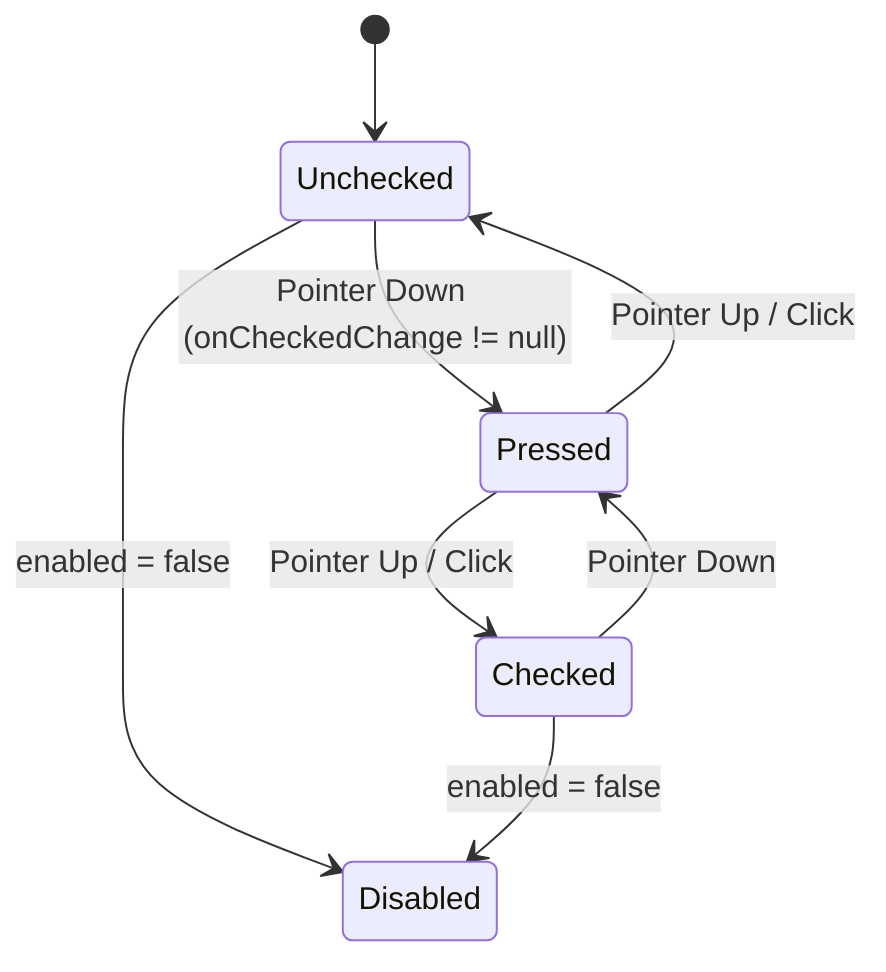

# AuraSwitch

> Instant boolean setting toggle representing an immediate binary state change (`On` / `Off`) without requiring an explicit form Save or Confirm button.

---

## 1. Intent & Usage Principles

### Problem

`AuraSwitch` provides crisp, physical pill-track toggling for immediate preferences across Aura apps (**Home Launcher** 3D wallpaper depth, **My Planner** all-day schedule mode, **My Finance** real-time price alert notifications, **My Drink Diary** cellar in-stock filter). It supports both compact standalone track toggles (`label == null`) and full-width labeled rows (`label != null`, optional `description`).

### When to Use

- Toggling a system setting, view mode, or feature flag that takes effect **immediately** (`SW-RULE-001`).
- Binary preferences inside settings sheets, inspect/playground panels, or schedule metadata rows (`All-day event`).
- Independent boolean flags that do not belong to a multi-select batch checklist.

### When NOT to Use & Alternatives

- **Multi-select checklists or task completion:** Use `AuraCheckbox` instead (`My Planner` todos, `My Finance` batch asset selection).
- **Mutually exclusive 2–5 options:** Use `AuraRadio` inside forms or `AuraSegmentedButton` for compact header view switchers (`Day | Week | Month`).
- **Actions requiring Save/Submit confirmation:** A toggle whose effect stays pending until a bottom Save button is tapped violates `INP-RULE-002`; use `AuraCheckbox`.

### Context Rules

- **`SW-RULE-001` (Immediate Commit Semantics):** Flipping `AuraSwitch` must apply and persist the change immediately. Never pair a switch with a separate confirmation dialog unless disabling a destructive safeguard.
- **`SW-RULE-002` (Affirmative Label Phrasing):** Always write `label` in the positive, active voice (e.g., `"3D Wallpaper Parallax"`, not `"Disable 3D Parallax"`) so `Checked` unequivocally means enabled.
- **`SW-RULE-003` (48dp Minimum Touch Hit Target):** Both `Medium` (`50 × 30dp`) and `Small` (`42 × 24dp`) visual tracks must live inside at least a `48dp × 48dp` interactive hit area (`44pt × 44pt` on iOS). When `label != null`, the entire row becomes the single `Role.Switch` toggle target.

### Do / Don't

| Do | Don't |
|---|---|
| Use `AuraSwitch` for immediate boolean settings like `"All-day schedule"` or `"Show tasting hints"`. | Use `AuraSwitch` inside a to-do checklist or multi-item deletion list (use `AuraCheckbox`). |
| Keep labels short and positive (`"Auto Rebalance"`, `"Compact Grid"`). | Invert label meaning (`"Hide prices off"`) that causes double-negative confusion. |
| Provide optional `description` beneath `label` when explaining side effects clearly. | Cram long multi-sentence paragraphs into inline compact controls without spacing. |
| Keep track and thumb tokens bound to `AuraTheme.colors` across Light & Dark themes. | Hardcode hex colors (`Color(0x...)`) or wrap Material `Switch` defaults. |

---

## 2. Anatomy & Canonical Part IDs

```text
  Standalone:                Labeled Row Mode:
  ┌───────────────────┐      ┌──────────────────────────────────────────┐
  │ ┌───────────────┐ │      │ 3D Parallax Effect            ┌────────┐ │
  │ │           (●) │ │      │ Subtle depth shift on tilt    │    (●) │ │
  │ └───────────────┘ │      │                               └────────┘ │
  └───────────────────┘      └──────────────────────────────────────────┘
       >= 48dp hit box              Full-row Role.Switch touch target
```

| Part ID | Responsibility | Required | Semantics Owner |
|---|---|---|---|
| `root` | Standalone `48dp` hit box, or the full labeled row when `label != null` | Yes | `Role.Switch` (`toggleable`) |
| `track` | Capsule container showing on/off fill and border | Yes | Decorative |
| `thumb` | Circular knob sliding between start and end | Yes | Decorative |
| `label` | Primary row text | No | Merged into `root` |
| `description` | Secondary row text below `label` | No | Merged into `root` |

---

## 3. Variant, Size & Material Matrix

| Size (`AuraSwitchSize`) | Track Width | Track Height | Thumb Diameter | Min Touch Height | Recommended Usage |
|---|---|---|---|---|---|
| `Medium` (default) | `50dp` | `30dp` | `24dp` | `48dp` | Settings screens, labelled option rows, modals |
| `Small` | `42dp` | `24dp` | `18dp` | `48dp` | Dense inspector toolbars, preview parameter rows, inline headers |

- **Layout modes:** Standalone (no `label`) or Labeled Row (`label` / `description` + trailing switch).
- **Material:** `Solid` only (`layer: content`).

---

## 4. State Precedence & Behavior

**State Precedence:** `Disabled` > `Pressed` > `Checked` / `Unchecked` (focused ring highlights `border.focus` when keyboard/DPAD focus is active on enabled controls).



---

## 5. Semantic Token Bindings

| Element | State | Light / Dark Semantic Token |
|---|---|---|
| Track Container | Checked (`Enabled`) | `AuraTheme.colors.brand.primary` |
| Track Container | Unchecked (`Enabled`) | `AuraTheme.colors.surface.sunken` |
| Track Container | `Disabled` (Checked / Unchecked) | `AuraTheme.colors.interaction.disabledContainer` |
| Track Border | Checked (`Enabled`) | `AuraTheme.colors.brand.primary` (`1.5dp`) |
| Track Border | Unchecked (`Enabled`) | `AuraTheme.colors.border.strong` (`1.5dp`) |
| Track Border | `Disabled` | `AuraTheme.colors.border.subtle` (`1dp`) |
| Thumb | Checked (`Enabled`) | `AuraTheme.colors.brand.onPrimary` |
| Thumb | Unchecked (`Enabled`) | `AuraTheme.colors.content.secondary` |
| Thumb | `Disabled` | `AuraTheme.colors.content.disabled` |
| Press Overlay | `Pressed` | `AuraTheme.colors.interaction.pressedOverlay` |
| `label` Text | `Enabled` / `Disabled` | `AuraTheme.colors.content.primary` / `content.disabled` (`typography.bodyLarge`) |
| `description` Text | `Enabled` / `Disabled` | `AuraTheme.colors.content.secondary` / `content.disabled` (`typography.bodySmall`) |

---

## 6. Interaction Motion Contract

Consumes `AuraTheme.motion` exclusively (`AuraMotion`):

1. **Thumb Translation:** Slide offset `0f -> 1f` animates with `AuraTheme.motion.selectionSpring()` (`0.6%` overshoot), landing on either end of the track without visible rebound (`MOT-RULE-008`). While pressed, the thumb widens to `AuraTheme.motion.grabScale` (`1.18f`).
2. **Tactile Press Feedback:** Uses `rememberAuraTactilePressed(interactionSource, motion.minPressDurationMillis)` (`110ms` minimum latch on fast taps). While pressed:
   - Overall visual track subtly compresses to `AuraTheme.motion.pressedScaleDefault` (`0.96f`) via `pressInSpring()` / `pressOutSpring()`.
   - Thumb gently elongates horizontally (`1.18x` width ratio) to feel physically pliable under the fingertip before snapping into its resting circle.
3. **Color Crossfade:** Track fill, border, and thumb tint transition via `tween(durationMillis = AuraTheme.motion.stateChangeDurationMillis)` (`150ms`).
4. **Reduced Motion Compliance:** When system `ANIMATOR_DURATION_SCALE == 0f` (`rememberAuraReducedMotion()`), spring/tween animations degrade to instant `snap()`.

---

## 7. Responsive Layout Behavior (`Smallest Width × Display Ratio`)

`AuraSwitch` adapts its row footprint and typography spacing cleanly across all Aura viewport classes and aspect profiles (`AuraWindowInfo`):

| Width / Display Profile | Standalone Behavior | Labeled Row (`label != null`) Behavior |
|---|---|---|
| `ExtraSmall` (`< 360dp`) | Fixed track dimensions (`Medium` or `Small`) centered in `48dp` touch bounds. | `label` and `description` occupy flexible `weight(1f)` with `12dp` horizontal gap before trailing track; text wraps gracefully up to 2 lines without clipping track. |
| `Compact` (`360–599dp`) | Maintains standard track geometry aligned to grid slots or trailing edge of list rows. | Full-width settings row (`fillMaxWidth()`) keeps track trailing-aligned with `16dp` end breathing room on phones. |
| `Square` (`~1:1` Pop-up / Split) | Preserves `48dp` minimum touch height during multi-window split resize without collapsing track width. | Prevents crowded multi-column wrapping by stacking row vertically below sibling switches inside compact pop-up panes. |
| `UltraWide` (`> 21:9` Outer Screen) | Keeps compact inspector controls anchored cleanly inside narrow outer strips. | Label takes single line while keeping track anchored strictly on the trailing edge of the row. |
| `Expanded` (`>= 840dp` Tablet) | Sits comfortably in inspector panes or secondary split panels alongside live previews. | Constrained within parent container (`AuraCard` or pane column `maxContentWidth`) so label and switch never drift awkwardly far apart across wide monitors. |

---

## 8. Accessibility & Guardrails

- [ ] Interactive root registers `Role.Switch` via `Modifier.toggleable(value = checked, ...)` when `onCheckedChange != null`.
- [ ] When `label != null`, TalkBack announces `"<label>, <description>, switch, on/off"` as a single focusable node rather than separate label + toggle nodes.
- [ ] Standalone track enforces `defaultMinSize(minWidth = 48.dp, minHeight = 48.dp)` and labeled rows enforce `heightIn(min = 48.dp)`.
- [ ] Unchecked track border uses `border.strong` to preserve `>= 3:1` non-text contrast against `surface.sunken` in both Light and Dark themes.
- [ ] Verified reduced-motion (`ANIMATOR_DURATION_SCALE = 0`) skips spring bounce without dropping state changes.

---

## 9. Platform Bindings

### 9.1 Android (Jetpack Compose)

- **Source:** [`AuraSwitch.kt`](../../../design-system/src/main/kotlin/com/example/ds/component/AuraSwitch.kt)

<!-- API:ANDROID:BEGIN -->
```kotlin
enum class AuraSwitchSize { Medium, Small }

@Composable
fun AuraSwitch(
    checked: Boolean,
    onCheckedChange: ((Boolean) -> Unit)?,
    modifier: Modifier = Modifier,
    size: AuraSwitchSize = AuraSwitchSize.Medium,
    enabled: Boolean = true,
    label: String? = null,
    description: String? = null,
)
```
<!-- API:ANDROID:END -->

### 9.2 iOS (SwiftUI Reference)

<!-- API:IOS:BEGIN -->
```swift
public enum AuraSwitchSize: Sendable {
    case medium
    case small
}

public struct AuraSwitch: View {
    public init(
        isOn: Binding<Bool>,
        size: AuraSwitchSize = .medium,
        isEnabled: Bool = true,
        label: String? = nil,
        description: String? = nil
    )
}
```
<!-- API:IOS:END -->

### 9.3 Web (React / TypeScript Reference)

<!-- API:WEB:BEGIN -->
```ts
export type AuraSwitchSize = 'medium' | 'small';

export interface AuraSwitchProps {
  checked: boolean;
  onCheckedChange?: (checked: boolean) => void;
  size?: AuraSwitchSize;
  disabled?: boolean;
  label?: string;
  description?: string;
  className?: string;
}
```
<!-- API:WEB:END -->
